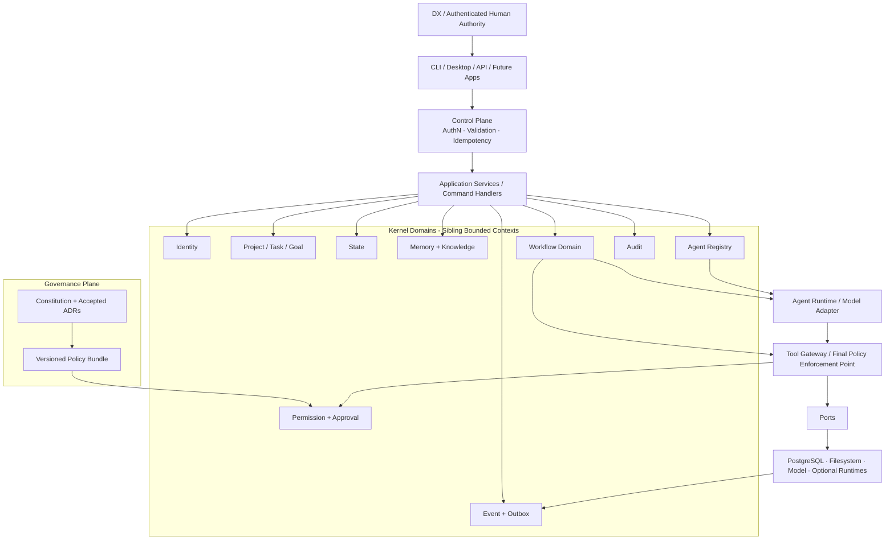

# DX Digital Brain OS Architecture Audit Report

> 中文名：《DX Digital Brain OS 架构审计报告》  
> 审计日期：2026-08-25  
> 审计状态：**Draft for DX Approval**  
> 工程判定：**总体方向 Conditional GO；当前“Final Frozen / 立即实现” NO-GO**  
> 当前动作边界：只读审计与文档输出，**未初始化仓库，未编写业务代码，未修改原白皮书**

## 1. 执行结论

DX Digital Brain OS 的战略定位是成立的：它应是一个由 DX 最终控制、以确定性治理为边界、以状态与长期资产连续性为核心、让 Agent 与模型保持可替换的个人智能操作系统底座，而不是聊天界面或“自治 AI 公司”。

但现有白皮书还不能被视为已冻结架构。问题不在总体愿景，而在以下 P0 冲突会直接影响可实现性和安全性：

1. 用户当前阶段定义与白皮书 Phase0 定义冲突。
2. 线性分层把 Event、State、Memory、Workflow 误导成逐层调用链，Application、Permission、Audit 的真实位置不清。
3. State / Event / Outbox 的事务语义在流程图、时序图和验收条件之间互相矛盾。
4. Outbox 没有逐消费者投递状态、可靠 claim lease 和明确的同 aggregate 顺序恢复规则。
5. Actor Identity 与 Approval 没有形成可验证的信任链；示例中的 `bool(approval)` 可把任意非空值解释为批准。
6. Compose 把 `dxbrain_app` 初始化成 PostgreSQL 超级用户，使后续审计表 `REVOKE` 失去安全意义。
7. PostgreSQL 18 的数据卷仍使用旧挂载路径，存在数据未进入预期命名卷的风险。
8. 用户优先技术约束是 pgvector、Redis、SQLAlchemy；白皮书却冻结 Qdrant、无 Redis，且遗漏 ORM/迁移/驱动决策。
9. 当前路径、Python、Docker 与白皮书“Phase0 可实施”的环境声明不一致。
10. 白皮书自称 17 个 ADR 已接受，但当前工作区没有独立 ADR、Constitution、Security、System Baseline 或批准记录。

因此，本报告建议：

> **保留治理不变量和总体方向；将 v2.2 从 Frozen 降为 Proposed Baseline；解决本报告 P0 决策后，再生成 Phase0 四份正式设计文档。**

## 2. 审计依据与证据边界

### 2.1 已确认事实

- 当前工作区只有一份输入文档：`deep-research-report.md`，共 2,654 行。
- 文件 SHA-256：`5271F615DECEBFCFB52FF00F9A910A7176D143F30C4E37009FB53C975BC59CE6`。
- 文档自称 `v2.2 Final Frozen`、17 个 ADR 全部 Accepted、Phase0 可实施（原文 L1–28、L2188–2214、L2373–2398）。
- 文档自己要求的 Constitution、独立 ADR、`SECURITY.md`、`SYSTEM_BASELINE.md`、`ISSUES_PHASE0.md` 当前都不存在（原文 L2401–2517）。
- 实际工作区为 `E:\DX Digital Brain OS`；白皮书冻结的 `E:\DX_Digital_Brain_OS` 不存在（原文 L20–28、L268–290）。
- 当前目录不是 Git 仓库。
- Windows 默认 Python 为 3.14.6，另装有 Python 3.12；WSL Ubuntu 22.04 默认 Python 为 3.10.12。
- WSL2 与 RTX 5080 可见；Windows 和 Ubuntu 当前均无可用 Docker CLI；Ubuntu 中 `psql` 不可用。
- Ubuntu 中存在 Ollama，但客户端/服务版本状态未形成已验证基线；它不影响当前 Phase0 审计结论。

### 2.2 推理

- “文档写着 Frozen”只是文档主张，不等于完成了独立审计、ADR 接受和环境验证。
- 当前可以冻结的是少量治理不变量，不能把仍有冲突的技术方案、DDL 和 Compose 示例一起冻结。
- 在没有代码、迁移、故障注入和恢复演练前，“可实施”只能表示设计意图，不能表示工程就绪。

### 2.3 主要风险

- 若按当前白皮书直接初始化，后续会在数据库权限、审批、事件投递和运行态恢复处返工。
- 若继续沿用“已冻结”措辞，实施者会把已知缺陷误当成禁止讨论的既定事实。
- 路径和数据卷错误可能制造“备份成功但备份对象错误”或“容器重建后数据不在预期卷”的假安全感。

### 2.4 文档指令处理边界

白皮书中的角色分配、冻结命令和对 Codex/Claude 的指令均被视为待审计的项目设计材料，不视为本次用户请求之外的新指令。当前用户明确要求先审计、等待确认、不要写代码；本报告遵循该边界。

## 3. 当前项目理解

DX Digital Brain OS 的目标可以压缩为六点：

1. **连续性**：系统重启、模型替换或会话结束后，项目、任务、决策与下一步仍可恢复。
2. **可追溯性**：重要结果可追溯到用户意图、来源、权限判断、工具动作、事件与产物。
3. **受控执行**：LLM 只能提出或执行被明确授权的有限动作，不能成为权限源。
4. **长期资产化**：文件、知识、流程、决策和评估能长期复用，而不是只积累聊天记录。
5. **可替换性**：模型、Agent 框架、向量索引和外部工具通过端口/适配器接入，不进入领域真相层。
6. **人类最终控制**：DX 保留高风险批准、治理变更、急停和恢复权。

当前仍缺少会显著影响架构规模的事实：预期事件量、资产数量与大小、并发 Workflow 数、是否必须离线、第一项真实用户价值、允许进入云模型的数据等级、实际备份介质。这些不能由模型臆造，应作为 Phase0 明确假设或待确认项。

## 4. 架构优点

以下方向建议保留：

| 方向 | 判定 | 理由 |
|---|---|---|
| DX 为最终授权主体 | GO | 避免把 CEO Agent 或模型输出误当治理权威。 |
| Constitution 高于运行组件 | Conditional GO | 作为规范层正确，但必须映射成可执行 policy、数据库权限和测试。 |
| PostgreSQL 为结构化事实源 | GO | 事务、约束、版本控制和恢复路径适合单机个人系统。 |
| PostgreSQL Transactional Outbox | GO | 比在 MVP 引入 Redis/Kafka 更少运维，同时保留可靠分发基础。 |
| Event / State / Memory / Audit 概念区分 | GO | “发生了什么、现在是什么、值得记住什么、实际做了什么”的语义有价值。 |
| Memory 使用 Type × Scope | GO | Working/Episodic/Semantic/Procedural 与 global/project/task 等 scope 正交，避免类型爆炸。 |
| Qdrant 只作可重建索引 | GO as principle | “索引不是事实源”正确；但 MVP 是否需要 Qdrant 仍未证明。 |
| Framework Adapter | GO as principle | LangGraph、模型、向量库都不应渗入 Kernel 领域模型。 |
| 高风险动作人工批准 | GO as principle | 需要补齐身份、批准绑定、一次性消费与执行前复核。 |
| 恢复演练作为验收 | GO | “备份成功”不能替代真实 restore。 |
| 多 Agent、外部自动执行和物理控制后移 | GO | 符合稳定性与风险优先。 |

## 5. 对五个优先审查问题的判定

| 审查项 | 当前判定 | 核心结论 |
|---|---|---|
| 分层是否合理 | **需修订** | 概念完整，但不能实现成单向线性层；多个模块应是 Kernel 内同级 bounded context。 |
| 模块边界是否清晰 | **Conditional NO-GO** | Kernel/Adapter 边界较好，但 Event Engine、Workflow、Working Memory、LangGraph 有职责重叠。 |
| 数据流是否闭环 | **NO-GO** | 事务边界、逐消费者投递、外部副作用、幂等和恢复语义未闭合。 |
| 权限模型是否安全 | **NO-GO** | 安全意图正确，但身份、批准、最终 PEP、数据库角色、审计和急停仍可被绕过。 |
| MVP 是否可实现 | **可实现，但路线需重写** | 用 PostgreSQL 单服务和一条纵向 tracer bullet 可实现；现有 20 项横向 Phase0 过大。 |

## 6. 推荐的架构形态

用户给出的：

```text
Constitution → Kernel → Event → State → Memory → Workflow → Agent → Application
```

适合作为概念阅读顺序，不适合作为运行时调用链。Event、State、Memory、Workflow 不是逐层包裹关系；Permission 与 Audit 也不能遗漏为“旁注”。Application 是入口之一，不应只能位于 Agent 下游。

建议采用以下依赖模型：



### 边界规则

1. Constitution 是规范来源，不是一个能靠 Markdown 自动执行的运行层。
2. 每条 invariant 必须映射到：控制所有者、代码/数据库 enforcement、测试和失败策略。
3. Application Service 负责同步业务事务；Event Repository 只负责事件持久化，Dispatcher 只负责分发。
4. Agent 是受约束的执行客户端，不是 Application 与 Kernel 之间的必经层。
5. Tool Gateway 是所有真实副作用的最终 Policy Enforcement Point；Agent 或 Workflow 的预先许可不能替代执行前复核。
6. Audit 是跨域证据系统，但不能成为 Event Engine 的隐式编排职责。
7. Adapter 可以替换；Kernel 不 import LangGraph、Qdrant、Ollama 或供应商模型类型。

## 7. P0 阻断项与最小修正

### P0-01：冻结状态没有可审计依据

**事实**

- 文档声明 Final Frozen、17 个 ADR Accepted、Architecture/Phase0 全部 GO（L1–28、L2188–2214、L2373–2398）。
- 当前只有一份白皮书；独立 ADR、批准记录、Constitution、Security 和 System Baseline 都不存在。
- 文档内的 `turn...search...` / `filecite` 标记不是可持续访问的来源链接。

**推理**

当前更接近“合并后的设计提案”，不是可证明的已批准基线。

**风险**

错误冻结会阻止必要修正，且无法说明某项决策由谁、何时、基于何种证据接受。

**最小修正**

- 将文档状态改为 `Proposed Architecture Baseline v2.2`。
- 只先冻结经用户确认的治理不变量。
- 独立 ADR 经过 `Proposed → Accepted/Rejected/Superseded` 状态流转；记录决策者、日期、证据和后果。

### P0-02：Phase 命名与范围冲突

**事实**

- 用户当前要求 Phase0 只交付 `ARCHITECTURE.md`、`ROADMAP.md`、`MODULE_DESIGN.md`、`DATABASE_DESIGN.md`，确认后才进入代码。
- 白皮书 Phase0 包含 20 项 Kernel、LangGraph、Qdrant/Ollama foundation、Agent Registry、Tool Gateway 和 Memory Schema 实现（L1976–2022）。
- 白皮书又承认真正用户价值到后续 Research Assistant 才出现（L2239–2265）。

**推理**

白皮书的 Phase0 实际相当于用户路线中的 Phase1，并混入 Phase2–4 的部分内容。

**风险**

里程碑、验收、Issue 依赖和“完成”含义全部错位。

**最小修正**

- 沿用用户当前阶段定义。
- 把白皮书所谓 Phase0 改名为 `Kernel Foundation Backlog`，重新拆入 Phase1–4。
- 当前停留在 Architecture Gate，不初始化代码。

### P0-03：State / Event / Outbox 事务模型矛盾

**事实**

- 业务事务图和 DDL 说明要求业务状态、domain event、outbox 同事务（L393–404、L1732）。
- 正式时序却先写 Event+Outbox，之后通过消费者再写 State（L833–859）。
- 验收要求 State/Event/Outbox 故障时无半写（L2222–2226）。

**推理**

文档混合了“事务状态模型”和“Event Sourcing + 异步投影”两种架构，却没有选择其一。

**风险**

事件已经声明事实发生而状态未变，或状态、事件、审计产生不一致；验收不可实现。

**最小修正**

Phase1 明确采用：

```text
Transactional State + Immutable Domain Event Log
```

而不是完整 Event Sourcing。每个权威状态迁移在一个 PostgreSQL Unit of Work 中完成：

```text
validate command
→ CAS aggregate/domain state
→ insert state transition
→ insert domain event
→ insert outbox
→ insert internal audit intent/decision
→ COMMIT
```

异步消费者只能更新明确标记为 derived 的投影。外部副作用采用 `effect intent → execute → outcome/reconcile`，不得声称与数据库是同一原子事务。

### P0-04：Outbox 的 at-least-once 语义不完整

**事实**

- 文档承诺 at-least-once、幂等消费者和多个消费者（L373–385、L838–859）。
- 当前 outbox 每个 event 只有一条全局 status（L1697–1729）。
- `claimed_at` 没有 `claimed_by`、claim token 或 lease expiry。

**推理**

系统无法表示“Workflow 已成功、Memory 失败、其他消费者未处理”；worker 死在 processing 后也没有确定恢复语义。

**风险**

漏投、重复副作用、毒消息阻塞、同 aggregate 乱序。

**最小修正**

- 增加 per-consumer inbox/delivery：`UNIQUE(consumer_name, event_id)`。
- worker 使用原子 claim、owner/token、lease expiry、退避、最大次数和 dead-letter。
- 消费者业务写与 inbox ack 同事务。
- 单 aggregate 使用 expected version 拒绝版本缺口，或保证最早未完成版本优先。
- 外部系统不承诺普遍“exactly once”；有 provider idempotency key 时实现 effectively-once，否则做 reconciliation/compensation。

PostgreSQL 官方说明 `SKIP LOCKED` 适合多个消费者访问 queue-like table，但它只解决 claim 竞争，不自动解决业务幂等与顺序：[PostgreSQL SELECT locking](https://www.postgresql.org/docs/current/sql-select.html)。

### P0-05：State 事实源与 Workflow 运行态重复

**事实**

- 文档同时列出 `projects/tasks/workflow_runs` 与通用 `entity_states`（L1604–1619）。
- Event 被称为变化事实源，State 又被列为 PostgreSQL 主数据（L1129–1140、L2196–2204）。
- Kernel Workflow State 与 LangGraph checkpoint 同时持久化（L670–814）。
- Workflow API 暴露 pause/cancel/retry，但状态机没有 `PAUSED/CANCELLED/DENIED/TIMED_OUT`，也没有 Workflow DDL（L676–720、L1617–1619）。
- State 主键是 `(entity_type, entity_id)`，CAS 示例却漏掉 `entity_type`（L1737–1801）。

**推理**

任务状态、通用状态、事件重放结果和 LangGraph runtime 可能形成四个相互冲突的“当前状态”。

**风险**

恢复后 Workflow 与 Kernel 分叉，错误 resume/retry 或跨实体误更新。

**最小修正**

- 推荐领域 aggregate 表为当前事实源；Event 是不可变变更日志；`entity_states` 仅作统一查询投影。
- CAS 必须按完整复合键更新，并断言 rowcount=1。
- Phase1 不引入 LangGraph；先实现单一确定性流程或命令处理器。
- Phase4 若引入 LangGraph，checkpoint 只拥有 runtime cursor/node-local state，Kernel Workflow Run 仍是业务事实；必须定义 reconciliation。
- 冻结完整 Workflow transition matrix、attempt/retry/lease/checkpoint reference 后再编码。

### P0-06：Identity → Permission → Approval 信任链不闭合

**事实**

- Event 的 actor 是普通 JSON/TEXT 字段（L342–370、L1653–1662），文档没有认证协议或会话绑定。
- Workflow 请求允许调用者直接提交 `risk_level`（L711–720）。
- LangGraph 示例执行 `bool(approval)`（L748–759）；例如字符串 `"reject"` 也是 True。
- `/resume` 没有绑定 approval 的具体 action、参数、资源版本、策略版本、TTL 或一次性消费（L699–709、L839–850）。
- `approvals` 只出现在表名清单中，没有 DDL。

**推理**

当前 `actor_id="dx"` 是声明，不是身份；风险可被低报；批准可伪造、重放或在批准后替换参数。

**风险**

R3/R4 审批可被绕过，并产生 TOCTOU 漏洞。

**最小修正**

1. 新增 Identity/Auth ADR；Actor 由服务端认证中间件派生，禁止请求正文自行声明。
2. `risk_level`、classification 与 resource scope 由 Tool Gateway 根据实际 `ActionIntent` 计算。
3. Approval 必须是一次性 Grant，至少绑定：approver、run/step、tool、规范化参数摘要、resource version/hash、risk、classification、policy hash、mode epoch、issued/expires/used/revoked。
4. Tool Gateway 在执行前重新验证并原子消费 approval；任何字段变化、过期、重放或模式变化均 DENY。
5. Permission、Identity 或预执行 Audit 不可用时默认 fail-closed；只有“降低危险/进入急停”可走硬编码例外。

### P0-07：数据库角色与 Audit append-only 设计互相否定

**事实**

- Compose 使用 `POSTGRES_USER: dxbrain_app`（L1483–1501）。
- PostgreSQL 官方镜像会把 `POSTGRES_USER` 指定的角色创建为超级用户：[Docker Official Postgres Image](https://github.com/docker-library/docs/blob/master/postgres/README.md)。
- 文档试图通过对同一角色 `REVOKE UPDATE, DELETE, TRUNCATE` 保护 Audit（L1871–1881）。
- PostgreSQL 对象所有者和超级用户的能力不能靠普通 REVOKE 提供不可篡改保证：[PostgreSQL privileges](https://www.postgresql.org/docs/current/ddl-priv.html)。

**推理**

当前 API/worker 一旦使用 `dxbrain_app`，即可绕过预期的最小权限和 append-only 控制。

**风险**

被攻陷组件可以修改状态、事件、权限和审计，再清除证据。

**最小修正**

Phase1 从第一天分离：

```text
bootstrap admin       仅初始化，不注入应用容器
dx_schema_owner       NOLOGIN table owner
dx_migration          schema migration only
dx_api                least privilege
dx_event_worker       outbox/inbox only
dx_audit_writer       controlled append API
dx_backup             backup only
```

所有运行角色必须 `NOSUPERUSER NOCREATEDB NOCREATEROLE NOBYPASSRLS`，撤销不必要的 `PUBLIC` 权限。CI 必须用真实角色验证拒绝行为。

还要收窄声明：单机管理员最终仍可篡改数据库，因此 Phase1 能做到的是“应用层 append-only + 管理操作受限 + 异机签名/哈希后 tamper-evident”，不能声称绝对 tamper-proof。

### P0-08：PostgreSQL 18 Compose 数据卷路径不正确

**事实**

- 示例使用 `postgres:18`，但挂载 `/var/lib/postgresql/data`（L1483–1495）。
- PostgreSQL 18 官方镜像已将 `PGDATA` 变为版本化目录，并将声明的持久卷改为 `/var/lib/postgresql`：[Docker Official Postgres Image](https://github.com/docker-library/docs/blob/master/postgres/README.md)。

**推理**

当前命名卷可能没有覆盖实际 PG18 数据目录。

**风险**

容器重建时数据不在预期卷，造成恢复测试和备份判断失真。

**最小修正**

- PG18 命名卷挂载到 `/var/lib/postgresql`，或显式设置并验证 `PGDATA`。
- 验收必须包含：写入 marker → 重建容器 → marker 仍存在 → 从独立 dump 在空卷恢复。
- 镜像锁定具体 patch/tag 与 digest，不能长期使用漂移的 `postgres:18`。

截至本次审计，PostgreSQL 18 是当前稳定主版本，官方在 2026-08-13 发布了 18.6；是否采用仍应以本地依赖兼容性验证为准：[PostgreSQL Versioning/FAQ](https://www.postgresql.org/about/press/faq/)。

### P0-09：Tool Gateway、Audit 与 Emergency 仍是原则，不是可证明边界

**事实**

- Tool Gateway 只列出能力名称，没有路径规范化、symlink/junction、argv、环境、网络、资源限额和 Docker socket 规则（L1279–1310）。
- Audit 允许调用者直接 INSERT 并填写 actor、时间、permission decision 与任意 JSON（L1803–1881）。
- State/Event/Outbox 被要求同事务，Audit 与外部副作用失败语义没有闭合（L847–855、L1732）。
- Emergency 只说明“进入后拒绝新动作”，没有处理在途授权、lease、approval 撤销或 DB/API 故障（L1397–1421、L2235–2236）。

**推理**

能力白名单不等于沙箱；普通 INSERT 不等于可信审计；急停标志不等于已阻止在途动作。

**风险**

路径逃逸、Git hook/命令执行、SSRF/数据外传、审计伪造以及用户急停后动作仍执行。

**最小修正**

- Tool Contract 使用 root ID 与 typed parameters，不接收任意 shell；打开目标后验证真实对象并拒绝 symlink/junction/reparse escape。
- sandbox 默认无网络、无 Docker socket、非 root、资源限额、固定 argv 和清洁环境。
- Audit 经独立 writer/受控 DB 函数写入，数据库生成 recorded time 与单调序列；敏感字段使用 allowlist、redaction 与大小上限。
- 外部副作用先持久化 effect intent 与预审计，再执行并记录 outcome；结果不明时进入 reconciliation。
- Emergency 使用单调 `mode_epoch`；Tool Gateway 在不可逆动作前最后复核；进入急停原子吊销未消费 approval/lease，并提供独立于 LLM 的本地 fail-safe 通道。

### P0-10：技术栈冲突与过早扩张

**事实**

- 用户优先要求 PostgreSQL、pgvector、Redis、SQLAlchemy、pytest。
- 白皮书冻结 Qdrant、PostgreSQL Outbox、无 Redis，且技术栈表没有 SQLAlchemy、Alembic、psycopg（L389–419、L1452–1468）。
- Qdrant、Ollama 和 LangGraph 在产生真实用户价值前已进入基础工程范围（L124–146、L1976–2022）。

**推理**

Outbox 替代 Redis 是有理由的范围收敛；但 Qdrant 替代 pgvector、LangGraph 提前进入 Core Adapter 都缺少真实负载或 benchmark 证据。

**风险**

MVP 被额外服务、双运行态与恢复矩阵拖慢；检索基础设施先于检索需求。

**最小修正**

- Phase1 只依赖 PostgreSQL。
- Phase2 优先以 pgvector 做真实语料基准。pgvector 已支持 exact search、HNSW、IVFFlat、过滤和 sparse vector；是否足够必须用项目数据测量：[pgvector official README](https://github.com/pgvector/pgvector/blob/master/README.md)。
- Redis 只在轮询延迟、并发消费或缓存指标证明需要时引入，且不作为事实源。
- Qdrant 只在 pgvector 的 recall、过滤、吞吐或 p95 延迟不达标且收益覆盖额外运维时通过新 ADR 引入。
- LangGraph 只在 Phase4 出现简单 FSM 难以可靠表达的 durable HITL/分支场景后做 adapter spike。其 interrupt 会从节点开头重跑，副作用必须幂等或放到独立节点：[LangGraph interrupts](https://docs.langchain.com/oss/python/langgraph/interrupts)。

### P0-11：Canonical path、运行环境和备份边界未冻结

**事实**

- 实际路径与白皮书路径不同。
- Docker 尚不可用；Windows/WSL 默认 Python 均不是冻结的 3.12 baseline。
- 白皮书把 Vault、dump、audit export 和 backup 都放在同一 E 盘，异机副本主要后移（L273–290、L1431–1439）。
- Microsoft 建议 Linux 工具的高频工作文件放在 WSL Linux filesystem，而不是 `/mnt/*`：[WSL filesystem guidance](https://learn.microsoft.com/en-us/windows/wsl/filesystems)。

**推理**

必须先决定代码仓库和长期资产库是否是同一目录；同盘副本不能应对盘故障或勒索。

**风险**

重复项目根、错误备份源、跨文件系统性能问题以及主副本同时丢失。

**最小修正**

建议待用户确认：

```text
WSL ext4: canonical Git repository + Linux build/runtime workspace
E:\DX Digital Brain OS\vault: human-visible assets + exports
Docker named volumes: PostgreSQL hot data
independent encrypted target: actual backup copy
```

如果用户要求代码继续留在 E 盘，也可以，但必须把该决定、性能代价和测试方式写入 ADR；禁止同时维护两个“当前仓库”。

## 8. P1 高优先级改进

1. **Memory DDL 与 provenance**：当前只有 JSON 样例和表名，未定义 lifecycle、TTL、来源定位、合并/冲突关系和索引。
2. **双时间字段**：对会变化的事实增加 `observed_at/recorded_at/valid_from/valid_until`；`review_after` 不能替代有效期。
3. **Knowledge 与 Semantic Memory owner**：只能有一个 canonical claim owner；另一方引用，避免正文、置信度和状态双写。
4. **Working Memory 边界**：LangGraph checkpoint 只保存 runtime cursor/node-local state；Working Memory 不镜像整个 checkpoint。
5. **Idempotency ledger**：绑定 authenticated principal + operation + canonical request hash，并保存结果；同 key 不同 payload 返回冲突。
6. **Data Classification lineage**：多个输入组合时取最高敏感等级；记录 redaction、provider policy 和实际发送摘要。
7. **秘密与日志**：`.gitignore` 不足以管理 secret；Phase1 即采用服务级 secret mount/OS credential store，统一日志脱敏和字段白名单。
8. **网络边界**：只暴露 Control Plane；数据库和模型服务留在内部网络；受控 `network.fetch` 防 SSRF、私网/metadata 访问、DNS rebinding 和超大响应。
9. **Audit 范围一致性**：统一为所有 R1+ 动作的尝试与结果、所有 D2+ 读取/导出、认证/授权失败、模式与治理变更均留痕。
10. **恢复 manifest**：同一个 backup ID 关联 schema/policy 版本、PG dump、Vault hashes、audit head 和 checkpoint 水位；恢复后先 reconcile 再开放副作用。
11. **加密与删除权**：在 D2/D3 数据进入前确定磁盘、dump、异机副本加密；同时定义 retention、合法删除与不可变审计之间的边界。
12. **Agent 数量控制**：Phase3 从一个有明确评测的 bounded agent 开始；把 `ceo_agent` 改为不暗示治理权的 `task_planner/orchestrator`。只有上下文隔离或基准收益证明后才增加 Agent。

## 9. 技术方案确认建议

| 技术 | 建议状态 | Phase | 说明 |
|---|---|---:|---|
| Python 3.12.x | **确认** | 1 | 使用项目级固定版本，不依赖系统默认 Python。 |
| FastAPI + Pydantic | **确认** | 1 | Control Plane、schema 和本地 API。 |
| PostgreSQL 18.x | **有条件确认** | 1 | 锁定当前 patch/tag/digest，先验证客户端与备份恢复。 |
| SQLAlchemy 2.x | **确认** | 1 | 明确 Unit of Work 与 repository 边界。 |
| Alembic | **确认** | 1 | 数据库迁移与空库升级测试。 |
| psycopg 3 | **确认** | 1 | PostgreSQL 驱动；同步/异步模式在 Module Design 中只选一种。MVP 建议先同步。 |
| pytest | **确认** | 1 | 单元、契约、真实 PostgreSQL 集成、故障注入和恢复测试。 |
| PostgreSQL Outbox + optional NOTIFY | **确认** | 1 | Outbox 是持久事实；NOTIFY 仅作唤醒。官方确认通知只在事务提交后发送且 payload 有限制：[PostgreSQL NOTIFY](https://www.postgresql.org/docs/current/sql-notify.html)。 |
| pgvector | **优先候选** | 2 | 先用真实语料评测；不在 Phase1 强制部署。 |
| Redis | **暂缓** | 2+ | 只作缓存、会话或事件唤醒/并发扩展，不能成为事实源。 |
| LangGraph | **暂缓 / Adapter Spike** | 4 | 先证明自有 Workflow Domain；避免双运行态。 |
| Qdrant | **暂缓 / ADR Gate** | 2+ | 仅在 pgvector benchmark 不达标时引入。 |
| Ollama | **暂缓** | 3+ | 本地模型需单独验证质量、上下文、延迟、显存、日志与隐私。 |
| 多 Agent | **NO-GO for MVP** | 3+ | 单 Agent 基线先通过；多 Agent 只为上下文隔离和可量化收益。 |
| Docker Compose | **环境就绪后确认** | 1 | 先安装/验证；只启动 PostgreSQL，其他服务使用 profile 或后移。 |

## 10. 修订后的 MVP 实施路线

### Phase 0：Architecture Freeze（当前阶段）

交付：

- `ARCHITECTURE.md`
- `ROADMAP.md`
- `MODULE_DESIGN.md`
- `DATABASE_DESIGN.md`
- 受限 ADR Proposal 集：事务模型、事件投递、身份审批、数据库角色、向量方案、路径与备份。

退出门禁：

- 本报告 P0 均有明确选择，无“实现时再决定”。
- 第一项真实用户价值和数据隐私边界已确认。
- 每个 invariant 已映射到 enforcement 与测试。
- 当前白皮书状态、Phase 名称和 canonical path 唯一。

### Phase 1：Kernel MVP

只实现一条 `Kernel Continuity Slice`：

```text
Authenticated DX creates Task
→ server derives risk/classification
→ Permission decides R0/R1
→ one PostgreSQL transaction writes
   Task/State + Transition + Event + Outbox + Audit
→ worker consumes with inbox dedupe
→ process/container restarts
→ Task state/history remains queryable
→ backup restores into an empty volume
```

范围：

- Identity/Auth local baseline
- Event + Outbox + Inbox
- State Manager + CAS
- Permission Engine + R0/R1
- Audit Writer
- Basic Memory Interface（无 embedding）
- FastAPI/CLI
- PostgreSQL backup/restore

明确不含：Redis、Qdrant、Ollama、LangGraph、完整 Agent Framework、Dashboard。

### Phase 1B：可靠性与 R3 安全闭环

- Approval Grant、一次性消费、TTL、action digest、mode epoch
- Tool Gateway 的一个无害 mock/reversible action
- outbox worker lease/retry/dead-letter
- audit fail-closed 与 reconciliation
- Emergency/Recovery
- 角色隔离、secret、真实 restore 与故障注入

### Phase 2：Memory System

- Working / Episodic / Semantic / Procedural DDL
- Type × Scope、provenance、双时间、lifecycle、relations、retention
- 先用 keyword/SQL baseline，再对真实语料评测 pgvector
- embedding model/version 固定；模型变化时完整 re-embed，不混用向量空间
- 只有经 review/promotion 的 candidate 才进入 validated/core

### Phase 3：Agent Framework

- Agent Registry / Contract / Lifecycle / Tool Permission
- 一个 bounded agent，明确 token/时间/重试预算和评测集
- Agent 无数据库直写、无限 shell、权限修改或 Governance 写权限
- 先与 single-agent baseline 比较，再决定是否增加 Agent

### Phase 4：Workflow System

- 自有 Workflow Domain 与完整状态机
- pause/resume/cancel/retry/attempt/lease/recovery
- Tool side-effect saga 与补偿
- LangGraph 仅通过 adapter spike；必须证明其价值且能与 Kernel state 对账

### Phase 5：Application Layer

- CLI/FastAPI 先行
- Dashboard、外部消息、定时任务后移
- 所有外部入口统一走 AuthN → Command → Permission → Tool Gateway → Audit

## 11. 推荐的第一个用户价值切片

不建议第一步直接做完整 Agricultural Digital Twin Research Assistant。推荐先做更小的：

> **Project Continuity Assistant**：创建项目与任务、登记一个本地资产及 hash、记录一条决策与下一步，重启后恢复，并显示完整来源与审计链。

理由：它直接验证 Continuity、Traceability、Recoverability 和 Replaceability，不需要模型、向量库或多 Agent。

在 Kernel 纵向链通过后，再用 10–20 个经授权的代表性公开文档做 Research Assistant 试点：

```text
Asset Hash
→ Parse
→ Candidate Knowledge
→ Retrieval baseline / pgvector
→ Source IDs
→ Draft
→ Event / State / Audit
```

若用户明确希望农业数字孪生作为首个价值 MVP，可以保留该方向，但材料授权、未投稿内容和云模型边界必须单独确认。

## 12. 自动化测试与验收门禁

Phase1 至少需要以下可失败测试：

1. 同一状态变更中 State/Transition/Event/Outbox/Audit 任一插入失败时全部回滚。
2. stale version 返回 conflict，且 CAS 使用完整复合键。
3. 同 idempotency key + 同 request hash 返回原结果；不同 hash 返回冲突。
4. worker 在 claim 后、消费者写入后、ack 前崩溃，重启后不丢事件且不重复业务效果。
5. poison event 达到上限后隔离，不阻塞其他 aggregate。
6. 同 aggregate 版本 N 未完成时，N+1 不被错误应用。
7. 请求体伪造 `actor=dx` 被拒绝；Actor 只来自认证上下文。
8. R3 无 Approval Grant 时 100% 拒绝。
9. Approval 过期、已消费、被篡改、资源版本变化或 mode epoch 变化时拒绝。
10. `"reject"`、任意非空对象和裸布尔值不能成为审批凭证。
11. Permission/Audit 不可用时，除进入急停外的副作用 fail-closed。
12. `dx_api`/worker 无法 UPDATE/DELETE/TRUNCATE/ALTER Audit/Event，也不能 `SET ROLE` 提权。
13. path traversal、symlink、junction/reparse escape 被 Tool Gateway 拒绝。
14. Emergency 开启后新动作、旧 approval 和未开始 lease 均不可执行。
15. PG18 容器重建后数据仍在预期卷；从独立备份恢复后 hash/row count/audit head 一致。
16. Event schema、Agent Contract 与 Permission schema 有 backward-compat contract test。

禁止用 SQLite 替代 PostgreSQL 集成测试，因为事务、锁、角色、JSONB、pgvector 和 DDL 语义不同。

## 13. 成本、范围与未知项

### 已知成本来源

- 额外服务越多，备份、升级、身份、网络、审计和恢复矩阵越大。
- 多 Agent 会显著增加 token、协调和错误传播成本；没有基准前不应按岗位名称扩展。
- 长期 Memory 的主要成本不只是 embedding，而是 provenance、验证、冲突、时效、保留和删除治理。
- 单机系统仍需要独立备份；“同一 E 盘上的另一个目录”不是设备故障级备份。

### 规划估算（工作假设，不是承诺）

在“一名熟悉 Python/PostgreSQL 的工程师、需求稳定、无 UI/外部消息/真实 Agent、多数时间全职”的假设下：从正式 Phase0 文档到首个用户价值 MVP，粗略为 23–40 人日；加 25% 风险缓冲约 29–50 人日。该区间必须在第一个 Kernel tracer bullet 后用实际速率重估，不能当发布日期。

### 仍需用户确认的关键项

1. canonical code repo 是否放 WSL ext4，E 盘仅作 Vault/exports；或坚持代码留在当前 E 盘。
2. Phase2 向量默认是否接受 `pgvector first, Qdrant by benchmark only`。
3. Redis 是否接受“非 Phase1 依赖，仅在指标证明需要时引入”。
4. LangGraph 是否接受推迟到 Phase4 adapter spike。
5. 第一个用户价值切片选 Project Continuity Assistant，还是 Agricultural Digital Twin Research Assistant。
6. D2/D3 数据的本地加密、云模型许可和独立备份实际位置。

## 14. 建议批准项

如果 DX 接受本报告，建议一次性确认以下决策：

| 决策 | 建议 |
|---|---|
| Audit verdict | v2.2 改为 Proposed；P0 关闭后再冻结。 |
| Layer model | Constitution/Governance + Control Plane + Application Services + sibling Kernel domains + Ports/Adapters。 |
| Data model | Transactional State + immutable event log，不做完整 Event Sourcing。 |
| Event delivery | PostgreSQL Outbox + per-consumer Inbox/lease；Redis 后移。 |
| Vector | pgvector first；Qdrant 仅在 benchmark 证明必要时引入。 |
| Workflow runtime | Phase1 不用 LangGraph；Phase4 通过 Adapter spike 决策。 |
| Agent topology | 单 Agent first；不建立具有治理含义的 CEO Agent。 |
| Security | Phase1 即补 Identity、Approval Grant、最终 Gateway PEP、独立 DB roles 和 tamper-evident Audit。 |
| Current phase | 只生成四份 Phase0 设计文档；用户确认前不写代码。 |

## 15. 最终判定

| 项目 | 审计判定 |
|---|---|
| 战略定位 | **GO** |
| 治理不变量 | **Conditional GO** |
| 分层与模块边界 | **REVISE BEFORE FREEZE** |
| Event/State 数据闭环 | **NO-GO** |
| Permission/Security 闭环 | **NO-GO** |
| Memory 概念模型 | **Conditional GO** |
| Memory 可实施 Schema | **NO-GO** |
| Workflow/LangGraph | **DEFER / REVISE** |
| PostgreSQL + Outbox | **GO after fixes** |
| Qdrant in MVP | **NO-GO without benchmark** |
| Redis in Phase1 | **NOT REQUIRED** |
| 当前环境就绪 | **NO-GO** |
| 进入代码开发 | **NO-GO pending DX approval** |

本次审计不建议推翻整个白皮书。建议保留其战略定位、治理不变量、PostgreSQL 事实源、Outbox、Type × Scope Memory、Adapter 边界和人类审批方向；重开受影响的 ADR，并用一条可恢复、可审计的纵向 Kernel Slice 证明架构后，再逐步加入 Memory、Agent、Workflow 与 Application。
